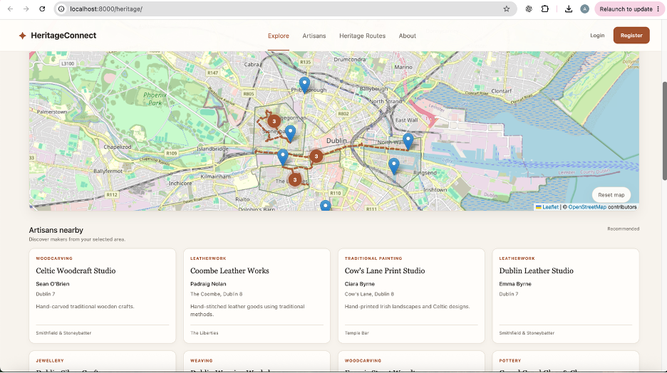
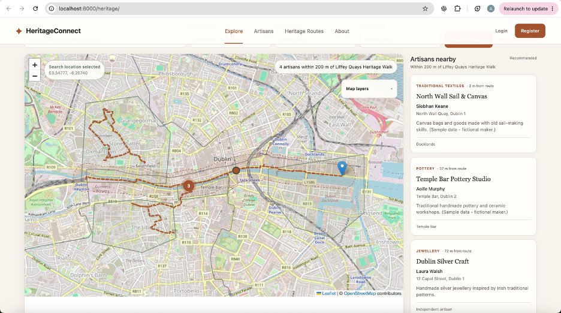
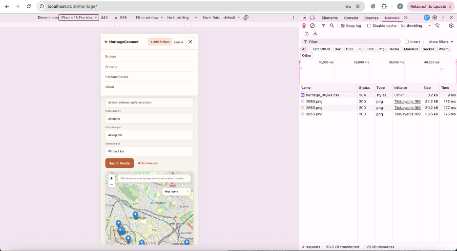
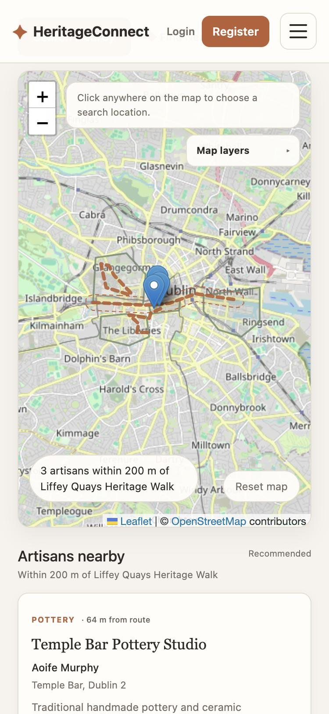
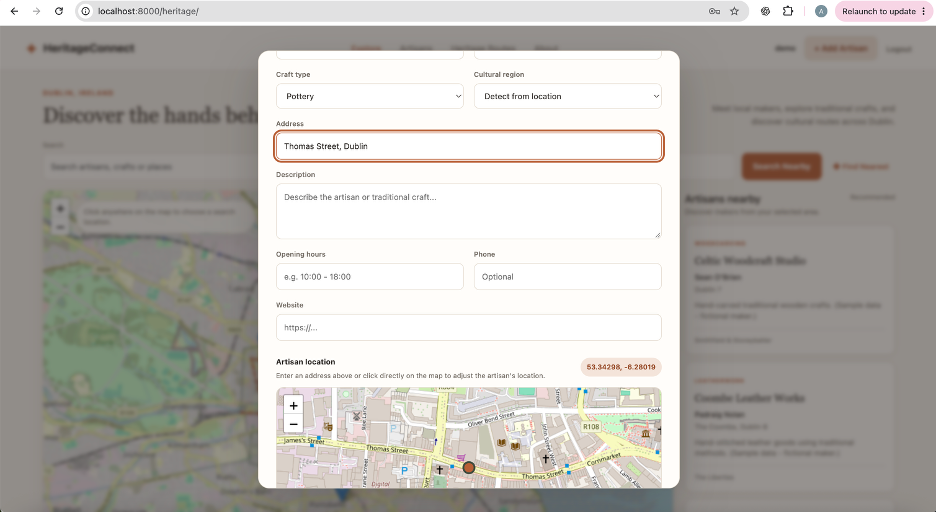
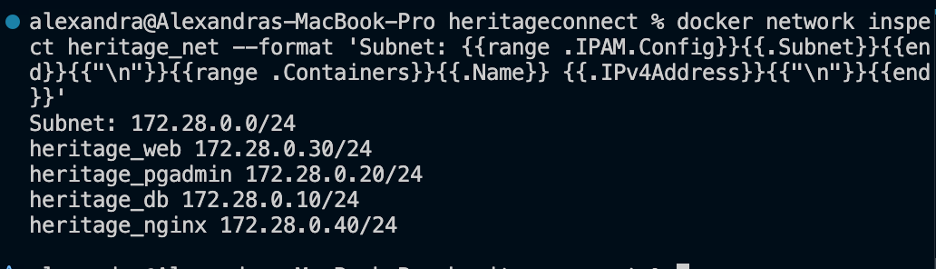
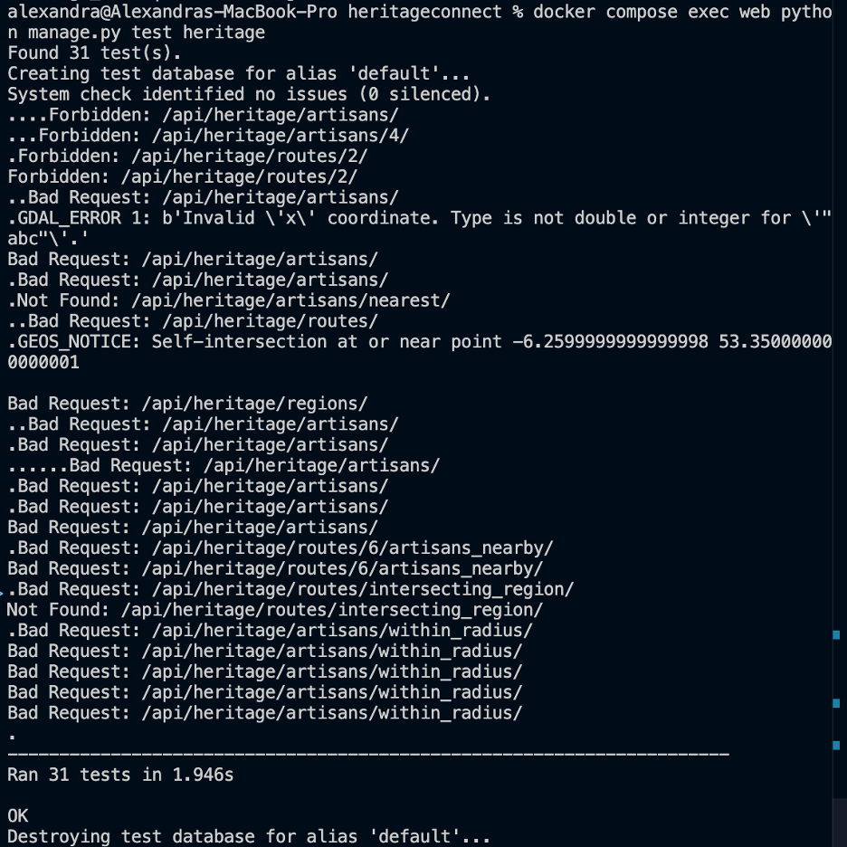
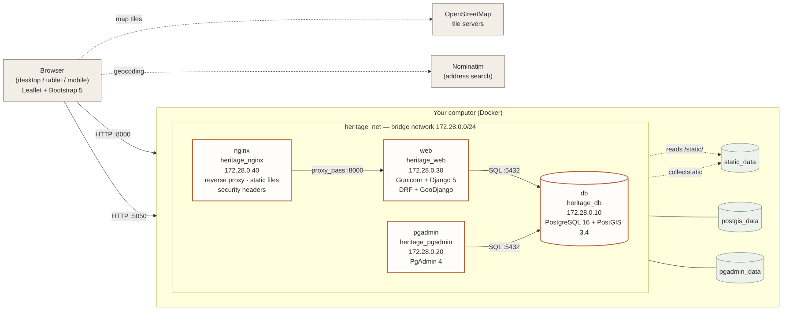
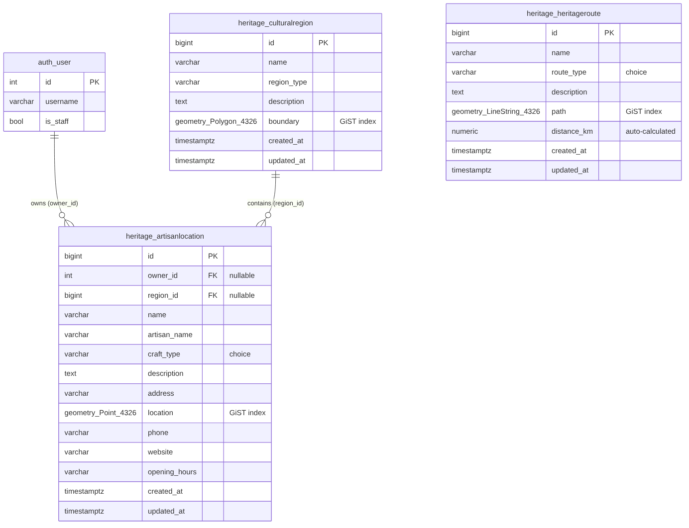

# HeritageConnect 

**Discover the hands behind the heritage.**
HeritageConnect is a location-based web application for finding traditional craft makers in
Dublin – potters, weavers, woodcarvers, silversmiths – and exploring the city's cultural
quarters and heritage trails on an interactive map.

Built for **CMPU4058 Advanced Web Mapping – Assignment 1 (Location-Based Services)**.

| | |
|---|---|
| **Map** | http://localhost:8000/ |
| **API (browsable)** | http://localhost:8000/api/heritage/ |
| **API docs (Swagger)** | http://localhost:8000/api/docs/ |
| **Django admin** | http://localhost:8000/admin/ |
| **PgAdmin 4** | http://localhost:5050/ |
| **Demo login** | `demo` / `HeritageDemo2026!` (see [Test credentials](#test-credentials)) |

---

## Contents

1. [Features](#features)
2. [Screenshots](#screenshots)
3. [Technology stack](#technology-stack)
4. [Architecture](#architecture)
5. [Database & spatial queries](#database--spatial-queries)
6. [Setup – local Docker deployment](#setup--local-docker-deployment)
7. [Cloud deployment](#cloud-deployment)
8. [Test credentials](#test-credentials)
9. [User guide](#user-guide)
10. [API documentation](#api-documentation)
11. [Security](#security)
12. [Testing](#testing)
13. [Project structure](#project-structure)
14. [Known issues & limitations](#known-issues--limitations)
15. [Acknowledgements & attribution](#acknowledgements--attribution)

---

## Features

**Map & discovery**
- Interactive Leaflet map with **OpenStreetMap** tiles, zoom/pan, popups and layer toggles
- Three spatial layers: **artisans** (points), **cultural regions** (polygons), **heritage routes** (lines)
- **Marker clustering** – nearby artisans merge into a numbered cluster that splits apart on zoom
- Search by text, filter by craft type and by cultural region
- **Search Nearby** – click the map (or use your location) and pick a radius (1–10 km)
- **Find Nearest** – the closest maker to a chosen point
- **Artisans along a route** – draws a 200 m / 500 m buffer corridor around a trail and lists the makers inside it, with their distance from the route
- Heritage route cards and an About / how-to section

**Accounts & data management (CRUD)**
- Register, log in, log out
- Logged-in users can **add** an artisan (address search *or* click on a mini map), and **edit / delete** their own artisans
- The cultural region of a new artisan is **detected automatically** from its location
- Regions and routes are curated by **staff** (Django admin or API)

**Responsive & accessible**
- Works on desktop, tablet and phone (mobile menu, collapsible map legend, no overlapping controls)
- Labelled form fields, screen-reader status messages (`aria-live`), visible keyboard focus
- Add/Edit dialog with `role="dialog"`, focus moved into the dialog, Tab kept inside it,
  Escape to close, and focus returned to the button that opened it

---

## Screenshots

> All screenshots are in [`docs/screenshots/`](docs/screenshots/).

| Interactive map | Artisans along a route (buffer query) |
|---|---|
|  |  |

| Mobile – menu | Mobile – route buffer | Add artisan form |
|---|---|---|
|  |  |  |

| Docker containers on the custom network | Automated tests |
|---|---|
|  |  |

More: [containers](docs/screenshots/A19-docker-containers.png) ·
[Nginx security headers](docs/screenshots/A20-nginx-security-headers.png) ·
[Swagger API docs](docs/screenshots/A25-swagger-api-docs.png) ·
[Buffer query in Swagger](docs/screenshots/A26-swagger-buffer-query.png) ·
[Django admin](docs/screenshots/A03-heritage-admin.png)

---

## Technology stack

| Layer | Technology |
|---|---|
| Database | PostgreSQL 16 + **PostGIS 3.4** (`postgis/postgis:16-3.4`), managed with **PgAdmin 4** |
| Middle tier | Python 3.12, **Django 5.2** + GeoDjango, Django REST Framework, djangorestframework-gis, django-filter, drf-spectacular (OpenAPI) |
| App server | **Gunicorn** (3 workers) |
| Reverse proxy | **Nginx 1.27** (static files, security headers, gzip) |
| Front end | **Leaflet 1.9.4** + **Leaflet.markercluster 1.5.3**, **Bootstrap 5.3**, vanilla JavaScript (Fetch API), Django templates |
| Map tiles | **OpenStreetMap** |
| Geocoding | OpenStreetMap **Nominatim** (address → coordinates in the Add Artisan form) |
| Deployment | **Docker Compose** – 4 containers on an isolated bridge network |

---

## Architecture



*Diagram source: [`docs/diagrams/architecture.mmd`](docs/diagrams/architecture.mmd)*

### How a request flows
1. The browser opens `http://localhost:8000` → **Nginx** (the only public entry point for the app).
2. Requests for `/static/…` (CSS, JS) are answered by **Nginx** directly.
3. Everything else is forwarded to **Gunicorn/Django** on the private network.
4. Django runs the view, queries **PostGIS** through the ORM (or parameterised SQL), and
   returns HTML or **GeoJSON**.
5. **Leaflet** draws the GeoJSON on top of OpenStreetMap tiles.

### Model-View-Controller in this project

| MVC role | Django component | Files |
|---|---|---|
| **Model** | GeoDjango models (PostGIS tables) | `heritage/models.py` |
| **View** (presentation) | Django template + Leaflet/JS/CSS | `templates/heritage_map.html`, `static/js/heritage_map.js`, `static/css/heritage_styles.css` |
| **Controller** | DRF ViewSets, URL routing, serializers (validation), permissions | `heritage/views.py`, `heritage/urls.py`, `heritage/serializers.py`, `heritage/permissions.py` |

### Containers and network

| Service | Container | IP on `heritage_net` (172.28.0.0/24) | Host port |
|---|---|---|---|
| `nginx` | heritage_nginx | 172.28.0.40 | **8000** → 80 |
| `web` (Gunicorn + Django) | heritage_web | 172.28.0.30 | – (private) |
| `db` (PostGIS) | heritage_db | 172.28.0.10 | – (private) |
| `pgadmin` | heritage_pgadmin | 172.28.0.20 | **5050** → 80 |

| Volume | Purpose |
|---|---|
| `postgis_data` | Database files – data survives restarts |
| `static_data` | Static files collected by Django, served by Nginx |
| `pgadmin_data` | PgAdmin settings |

---

## Database & spatial queries

Full documentation: **[`docs/database-schema.md`](docs/database-schema.md)**



| Table | Geometry | Index |
|---|---|---|
| `heritage_culturalregion` | `boundary` – Polygon, SRID 4326 | GiST |
| `heritage_artisanlocation` | `location` – Point, SRID 4326 | GiST |
| `heritage_heritageroute` | `path` – LineString, SRID 4326 | GiST |

### Spatial queries

| # | Question it answers | PostGIS | Endpoint |
|---|---|---|---|
| 1 | Which makers are within *r* km of me? | `ST_DWithin` (index pre-filter) + `ST_DistanceSphere` | `/api/heritage/artisans/within_radius/?lat=&lng=&radius=` |
| 2 | Which maker is closest? | KNN `<->` (index-ordered) + `ST_DistanceSphere` | `/api/heritage/artisans/nearest/?lat=&lng=` |
| 3 | Which makers are inside this cultural region? | `ST_Within` | `/api/heritage/regions/{id}/artisans/` |
| 4 | Which routes pass through this region? | `ST_Intersects` | `/api/heritage/routes/intersecting_region/?region_id=` |
| 5 | Which makers can I visit along this route? | `ST_Buffer`, `ST_DWithin`, `ST_Distance` (geography, metres) | `/api/heritage/routes/{id}/artisans_nearby/?distance=` |

Also: new artisans are linked to their region with `ST_Contains`, and route lengths are
calculated by projecting the line to **EPSG:2157 (Irish Transverse Mercator)**.

### Query performance and indexes
- Geometry columns have **GiST** indexes; migration `0003` adds GiST **expression indexes on
  `location::geography` and `path::geography`** for the metre-based buffer query.
- The radius search first uses an **index-friendly `ST_DWithin` box** (degrees), then checks the
  exact distance only on the rows that pass.
- The nearest search uses the PostGIS **KNN operator `<->`**, which walks the index instead of
  measuring every row, then confirms the closest of the top 5 in metres.
- See the query plans yourself:
  ```bash
  docker compose exec web python manage.py explain_spatial_queries
  ```
  (With only ~15 rows PostgreSQL normally prefers a full table scan, so this command switches
  sequential scans off for its own connection to show how the indexes are used at scale.)

---

## Setup – local Docker deployment

### Prerequisites
- [Docker Desktop](https://www.docker.com/products/docker-desktop/) (includes Docker Compose)
- Git
- Free ports **8000** and **5050**

### 1. Get the code
```bash
git clone <repository-url>
cd heritageconnect
```

### 2. Create your `.env` file
```bash
cp .env.example .env
```
Edit `.env` and set real values for `POSTGRES_PASSWORD`, `PGADMIN_DEFAULT_PASSWORD` and
`DJANGO_SECRET_KEY`. Generate a secret key with:
```bash
python3 -c "import secrets; print(secrets.token_urlsafe(50))"
```
`.env.example` starts in **production mode** (`DJANGO_DEBUG=False`), which is the
setting used for assessment.

### 3. Build and start
```bash
docker compose up -d --build
docker compose ps        # wait until web and db show "healthy"
```
On start-up the web container automatically runs database **migrations** and
**collectstatic**, then starts **Gunicorn**. The application code is built **into the image**
(no source-code mounts), so after changing code run `docker compose up -d --build`.

**Development mode (optional):** set `DJANGO_DEBUG=True` in `.env` and add the development
override, which mounts the source code for live reload:
```bash
docker compose -f compose.yaml -f compose.dev.yaml up -d
```

### 4. Load sample data and accounts
```bash
docker compose exec web python manage.py load_heritage_data   # 4 regions, 3 routes, 12 artisans
docker compose exec web python manage.py create_demo_user     # demo account
docker compose exec web python manage.py createsuperuser      # your own admin (optional)
```

### 5. Open the app
- Map: **http://localhost:8000/**
- PgAdmin: **http://localhost:5050/** → add a server with host **`db`**, port `5432`, and the
  database user/password from `.env`

### Useful commands
| Task | Command |
|---|---|
| View logs | `docker compose logs -f web` |
| Stop (keeps data) | `docker compose down` |
| Start again | `docker compose up -d` |
| Run tests | `docker compose exec web python manage.py test heritage -v 2` |
| Show spatial query plans | `docker compose exec web python manage.py explain_spatial_queries` |
| Rebuild after code changes | `docker compose up -d --build` |
| Inspect network | `docker network inspect heritage_net` |
| ⚠️ Delete everything incl. database | `docker compose down -v` |

---

## Cloud deployment

The assignment brief states that **local containerised deployment is sufficient**, so the
application has **not** been deployed to a cloud provider. Because everything runs in Docker
Compose, a cloud deployment would follow the same steps on a Linux VM (e.g. Azure, AWS EC2,
DigitalOcean):

1. Install Docker on the VM, clone the repository, create `.env`.
2. Set `DJANGO_DEBUG=False`, add the server's domain to `DJANGO_ALLOWED_HOSTS` and
   `DJANGO_CSRF_TRUSTED_ORIGINS`.
3. Add HTTPS (e.g. Let's Encrypt certificate in Nginx), then set `DJANGO_SECURE_COOKIES=True`
   in `.env` and run `docker compose up -d` (Compose passes it to Django, which then enables
   secure cookies, HSTS and HTTPS redirect). Leave it `False` on plain HTTP, or the login
   cookie will not be sent.
4. Remove the public PgAdmin port or restrict it with a firewall.
5. `docker compose up -d --build`.

---

## Test credentials

| Role | Username | Password | Can do |
|---|---|---|---|
| Normal user | `demo` | `HeritageDemo2026!` | Browse, add artisans, edit/delete **own** artisans (owns *Demo Basket Weaver*) |
| Admin | create with `createsuperuser` | – | Everything, incl. regions & routes in `/admin/` |

Create or reset the demo account at any time:
```bash
docker compose exec web python manage.py create_demo_user
```
The demo password is for local demonstration only (configurable via `DEMO_USER_PASSWORD`).

---

## User guide

| I want to… | How |
|---|---|
| Browse makers | Open the map. Click a marker for details, or click a card in the list to zoom to it. |
| Search | Type in **Search** (name, maker, craft or place) and/or choose a **Craft category**. |
| See one cultural area | Choose a **Cultural region**. Only makers inside that polygon are listed. |
| Find makers near a place | Click the map (or allow location), choose a **Search radius**, press **Search Nearby**. |
| Find the closest maker | Choose a point, press **◆ Find Nearest**. |
| Plan a walk | Scroll to **Heritage routes** and press **Artisans within 200 m**, or click a route on the map and choose *within 200 m / 500 m*. |
| Show/hide layers | Use the **Map layers** box on the map (tap it to open on mobile). |
| Add my workshop | **Register / Login → + Add Artisan**. Type an address (it is found on the map) or click the mini map, then **Save**. |
| Edit or delete | Your own artisans show **Edit** / **Delete** in the list. |
| Start again | **Reset map**. |

---

## API documentation

Interactive documentation: **http://localhost:8000/api/docs/** (OpenAPI/Swagger, generated by drf-spectacular).
All spatial responses are **GeoJSON** (`Feature` / `FeatureCollection`).
List endpoints are paginated (20 per page, follow `next`).

### Endpoints

| Method | URL | Who | Description |
|---|---|---|---|
| GET | `/api/heritage/artisans/` | anyone | List artisans. Query: `search`, `craft_type`, `region`, `owner`, `ordering`, `page` |
| POST | `/api/heritage/artisans/` | logged in | Create artisan (owner = current user) |
| GET | `/api/heritage/artisans/{id}/` | anyone | One artisan |
| PUT / PATCH | `/api/heritage/artisans/{id}/` | owner / staff | Update |
| DELETE | `/api/heritage/artisans/{id}/` | owner / staff | Delete |
| GET | `/api/heritage/artisans/within_radius/?lat=&lng=&radius=` | anyone | **Proximity** (radius in km, 0.01–50) |
| GET | `/api/heritage/artisans/nearest/?lat=&lng=` | anyone | **Nearest** artisan + distance |
| GET | `/api/heritage/regions/` | anyone | List regions (with `artisan_count`) |
| POST / PUT / PATCH / DELETE | `/api/heritage/regions/…` | staff | Manage regions |
| GET | `/api/heritage/regions/{id}/artisans/` | anyone | **Containment** |
| GET | `/api/heritage/routes/` | anyone | List routes. Query: `search`, `route_type`, `ordering` |
| POST / PUT / PATCH / DELETE | `/api/heritage/routes/…` | staff | Manage routes |
| GET | `/api/heritage/routes/intersecting_region/?region_id=` | anyone | **Intersection** |
| GET | `/api/heritage/routes/{id}/artisans_nearby/?distance=` | anyone | **Buffer** (metres, 10–2000, default 200) |

### Example – create an artisan
```http
POST /api/heritage/artisans/
Content-Type: application/json
X-CSRFToken: <csrftoken cookie>

{
  "type": "Feature",
  "geometry": { "type": "Point", "coordinates": [-6.2780, 53.3405] },
  "properties": {
    "name": "Meath Street Baskets",
    "artisan_name": "Aoife Murphy",
    "craft_type": "WEAVING",
    "address": "Meath Street, Dublin 8",
    "phone": "+353 1 555 0100"
  }
}
```
`201 Created` returns the new Feature, with `region` filled in automatically.

### Example – buffer query
(IDs, distances and counts depend on the loaded data.)
```http
GET /api/heritage/routes/3/artisans_nearby/?distance=200
```
```json
{
  "route": { "id": 3, "name": "Liffey Quays Heritage Walk", "distance_km": "3.79" },
  "buffer_m": 200.0,
  "buffer": { "type": "Polygon", "coordinates": [ ... ] },
  "count": 3,
  "artisans": { "type": "FeatureCollection", "features": [
    { "type": "Feature", "properties": { "name": "Temple Bar Pottery Studio", "distance_to_route_m": 64, ... } }
  ] }
}
```

### Errors
| Status | When | Example body |
|---|---|---|
| 400 | Missing / invalid / out-of-range input | `{"error": "'lat' must be between -90 and 90."}` or `{"phone": ["Phone may only contain digits, spaces, +, -, ( and )."]}` |
| 403 | Not logged in, or not the owner / staff | `{"detail": "You do not have permission to perform this action."}` |
| 404 | Unknown id | `{"error": "Cultural region not found."}` |
| 429 | Rate limit exceeded (120/min anonymous, 300/min logged in) | `{"detail": "Request was throttled. ..."}` |

---

## Security

| Area | Measure |
|---|---|
| Secrets | All passwords/keys in `.env` (git-ignored, Docker-ignored); `.env.example` has placeholders only |
| Network | Database and Django are **not exposed** to the host – only Nginx (8000) and PgAdmin (5050) |
| Containers | Django runs as a **non-root** user; code baked into the image (no source mounts in production); `.dockerignore` keeps `.env` and `.git` out of the image |
| Django | `DEBUG` off by default, `ALLOWED_HOSTS` / CSRF trusted origins from `.env`, CORS restricted, session cookie HTTP-only, `X_FRAME_OPTIONS=DENY`, optional HTTPS settings (`DJANGO_SECURE_COOKIES`) |
| Nginx | Hides version, `X-Content-Type-Options`, `X-Frame-Options`, `Referrer-Policy`, `Permissions-Policy`, request size limit |
| API | Object-level permissions (owner / staff), rate limiting, input validation, owner always taken from the session |
| Database | ORM queries + **parameterised** raw SQL (no string concatenation → no SQL injection); geometry type and validity checked before saving |
| Front end | All user text is **HTML-escaped** before display (prevents stored XSS); CSRF token on every write |

---

## Testing

```bash
docker compose exec web python manage.py test heritage -v 2
```
31 automated tests in [`heritage/tests.py`](heritage/tests.py), run against a temporary
PostGIS test database:

| Group | Tests |
|---|---|
| Models | automatic region detection, automatic route length |
| Permissions | read access, anonymous blocked, owner set from session, owner-only edit, staff moderation, staff-only regions/routes |
| Validation | bad / missing / out-of-range parameters, outside Ireland, bad phone, blank name, point outside chosen region |
| Robustness | wrong geometry type, missing geometry, garbage coordinates, swapped lat/lng, broken JSON, self-intersecting polygon, one-point route, empty results, no data |
| Spatial queries | radius (incl. ordering), nearest, containment, intersection, buffer (200 m vs 1 km) |
| Pages | home redirect, map page loads Leaflet |

Manual testing: desktop browser and phone-sized viewport (375 px) emulation.
Tested on Chrome 130 and Safari 18 (macOS), and on an iPhone using Chrome DevTools device mode.

---

## Project structure

```
heritageconnect/
├── compose.yaml              # 4 services, custom network, volumes (production-style)
├── compose.dev.yaml          # development override: live code mounts
├── Dockerfile                # Django/GeoDjango image (non-root)
├── docker/entrypoint.sh      # migrate → collectstatic → gunicorn
├── nginx/nginx.conf          # reverse proxy, static files, security headers
├── .env.example              # environment variable template
├── requirements.txt
├── manage.py
├── hello_map/                # Django project package
│   ├── settings.py           # settings from environment variables
│   └── urls.py               # top-level routes
├── heritage/                 # HeritageConnect app
│   ├── models.py             # Model – PostGIS tables
│   ├── serializers.py        # GeoJSON + validation
│   ├── views.py              # Controller – API + spatial queries
│   ├── permissions.py        # owner / staff rules
│   ├── urls.py               # API router
│   ├── admin.py              # Django admin (map widgets)
│   ├── tests.py              # 31 automated tests
│   ├── migrations/           # database schema migrations
│   ├── data/                 # heritage_routes.geojson (street-following route geometry)
│   └── management/commands/  # load_heritage_data, create_demo_user, explain_spatial_queries
├── templates/
│   ├── heritage_map.html     # View – main page
│   └── registration/         # login / register pages
├── static/
│   ├── js/heritage_map.js    # Leaflet map + API calls
│   └── css/heritage_styles.css
└── docs/
    ├── database-schema.md
    ├── architecture-diagram.png
    ├── database-schema.png
    ├── diagrams/             # Mermaid sources of the diagrams
    └── screenshots/
```

---

## Known issues & limitations

- **Sample data:** the 12 sample artisans are fictional; region boundaries are simplified
  approximations of real Dublin areas. Heritage routes follow real streets (OSRM walking routes
  on OpenStreetMap data), but they are pre-calculated and stored, not routed live in the app.
- **HTTP only locally:** there is no TLS certificate in the local setup; HTTPS settings exist
  but are switched off (`DJANGO_SECURE_COOKIES=False`).
- **Geocoding:** address search uses the public Nominatim service, which has a usage limit
  (about 1 request/second) and needs internet access. Clicking the mini map always works.
- **Apple Silicon:** the official `postgis/postgis` image is amd64-only, so on M-series Macs
  Docker runs it through emulation (declared with `platform: linux/amd64`). It works, but the
  database starts a little slower.
- **Small dataset:** with ~15 rows PostgreSQL chooses full table scans; the spatial indexes
  pay off as data grows (see `explain_spatial_queries`).
- **Regions** are single polygons (no multi-polygons) and regions/routes can only be edited
  by staff (Django admin), not in the public map interface.
- **Map tiles** come from the public OpenStreetMap tile servers, which are fine for a student
  project but not for heavy production traffic.
- **Development mode:** only with `DJANGO_DEBUG=True` **and** `compose.dev.yaml` do code changes
  apply without a rebuild; the default production setup is used for demos and submission.

---

## Acknowledgements & attribution

- Map data © [OpenStreetMap](https://www.openstreetmap.org/copyright) contributors; geocoding by Nominatim
- Heritage route geometry: walking routes between the trail's artisans, calculated once with
  [OSRM](https://project-osrm.org/) (FOSSGIS server `routing.openstreetmap.de`) on OpenStreetMap
  data (ODbL) and stored in `heritage/data/heritage_routes.geojson`
- [Leaflet](https://leafletjs.com/), [Leaflet.markercluster](https://github.com/Leaflet/Leaflet.markercluster), [Bootstrap](https://getbootstrap.com/),
  [Django](https://www.djangoproject.com/), [Django REST Framework](https://www.django-rest-framework.org/),
  [djangorestframework-gis](https://github.com/openwisp/django-rest-framework-gis),
  [drf-spectacular](https://drf-spectacular.readthedocs.io/), [PostGIS](https://postgis.net/),
  [Nginx](https://nginx.org/), [Gunicorn](https://gunicorn.org/)
- Docker images: `postgis/postgis`, `dpage/pgadmin4`, `nginx`, `python`
- Project setup based on the CMPU4058 lab exercises (Weeks 1–4)

