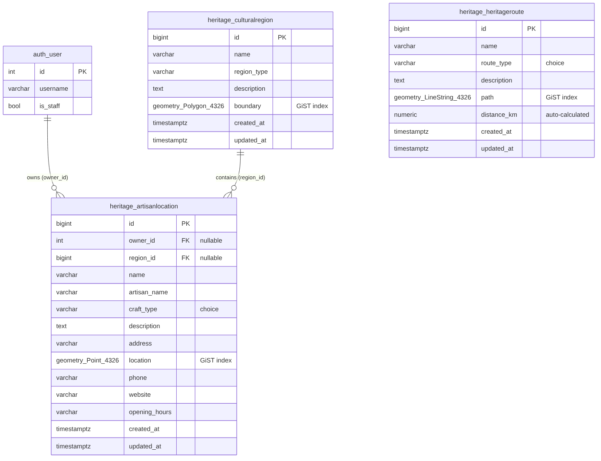

# Database Schema – HeritageConnect

HeritageConnect stores its data in **PostgreSQL 16 with the PostGIS 3.4 extension**.
The schema is defined by Django models in [`heritage/models.py`](../heritage/models.py)
and created by the migrations in [`heritage/migrations/`](../heritage/migrations/).



*Diagram source: [`diagrams/database-schema.mmd`](diagrams/database-schema.mmd)*

---

## 1. Spatial design at a glance

| Table | Geometry column | PostGIS type | SRID | What it represents |
|---|---|---|---|---|
| `heritage_culturalregion` | `boundary` | `Polygon` | 4326 | A cultural area, e.g. *The Liberties* |
| `heritage_artisanlocation` | `location` | `Point` | 4326 | One maker / workshop |
| `heritage_heritageroute` | `path` | `LineString` | 4326 | A walking or craft trail |

**Why SRID 4326 (WGS84 longitude/latitude)?** It is the coordinate system used by GPS,
GeoJSON and Leaflet, so data can go from the database to the map without conversion.

**Why EPSG:2157 (Irish Transverse Mercator) as well?** Degrees are not a distance. When the
app needs an accurate length in metres (route length), the geometry is projected to
EPSG:2157, which is the official metric projection for Ireland.

---

## 2. Tables

### `heritage_culturalregion` – polygons

| Column | Type | Null | Notes |
|---|---|---|---|
| `id` | bigint | no | Primary key |
| `name` | varchar(150) | no | Must not be blank (API validation) |
| `region_type` | varchar(100) | no | e.g. "Historic Quarter" |
| `description` | text | yes (blank) | |
| `boundary` | geometry(Polygon, 4326) | no | **GiST spatial index**; must be a valid polygon (API validation) |
| `created_at` / `updated_at` | timestamptz | no | Set automatically |

### `heritage_artisanlocation` – points

| Column | Type | Null | Notes |
|---|---|---|---|
| `id` | bigint | no | Primary key |
| `owner_id` | integer → `auth_user.id` | yes | User who created it. Django `on_delete=SET_NULL` (kept if the user is deleted). B-tree index |
| `region_id` | bigint → `heritage_culturalregion.id` | yes | Django `on_delete=SET_NULL`. B-tree index. **Filled automatically** with the region that contains the point |
| `name` | varchar(150) | no | Workshop name |
| `artisan_name` | varchar(150) | no | Maker's name |
| `craft_type` | varchar(50) | no | One of: POTTERY, WEAVING, WOODCARVING, TEXTILES, JEWELLERY, LEATHER, PAINTING, OTHER |
| `description` | text | blank | |
| `address` | varchar(255) | no | |
| `location` | geometry(Point, 4326) | no | **GiST spatial index**; must be inside Ireland (API validation) |
| `phone` | varchar(50) | blank | Digits, spaces, `+ - ( )` only (API validation) |
| `website` | varchar(200) | blank | Must be a valid URL |
| `opening_hours` | varchar(255) | blank | |
| `created_at` / `updated_at` | timestamptz | no | Set automatically |

### `heritage_heritageroute` – lines

| Column | Type | Null | Notes |
|---|---|---|---|
| `id` | bigint | no | Primary key |
| `name` | varchar(150) | no | |
| `route_type` | varchar(50) | no | One of: WALKING, CRAFT, CULTURAL, CYCLING, OTHER |
| `description` | text | blank | |
| `path` | geometry(LineString, 4326) | no | **GiST spatial index**; at least 2 points |
| `distance_km` | numeric(8,2) | yes | **Calculated automatically** from `path` (projected to EPSG:2157) |
| `created_at` / `updated_at` | timestamptz | no | Set automatically |

`auth_user` is Django's built-in user table (username, hashed password, `is_staff`, …).

---

## 3. Relationships

| Relationship | Type | Rule |
|---|---|---|
| User → Artisans | one-to-many | A user can own many artisans. Only the owner (or staff) may edit/delete. |
| Region → Artisans | one-to-many | Stored as a foreign key **and** checked spatially: if a region is chosen, the point must lie inside its polygon. |
| Region ↔ Route | spatial only | No foreign key – the link is calculated with `ST_Intersects` when needed. |

---

## 4. Indexes

| Index | Type | Why |
|---|---|---|
| `boundary`, `location`, `path` | **GiST** (created by GeoDjango, `spatial_index=True`) | Speeds up spatial filters such as `ST_Within`, `ST_Intersects` and bounding-box checks |
| `owner_id`, `region_id` | B-tree (created for every foreign key) | Fast joins and "artisans in region X" lookups |
| `id` | B-tree (primary key) | |

You can list the indexes yourself:

```bash
docker compose exec db psql -U "$POSTGRES_USER" -d "$POSTGRES_DB" \
  -c "SELECT tablename, indexname, indexdef FROM pg_indexes WHERE tablename LIKE 'heritage_%' ORDER BY tablename;"
```

---

## 5. Spatial queries using this schema

| # | Feature | PostGIS functions | Endpoint |
|---|---|---|---|
| 1 | Proximity – artisans within *r* km | `ST_DistanceSphere` | `GET /api/heritage/artisans/within_radius/` |
| 2 | Nearest artisan | `ST_DistanceSphere` + `ORDER BY` | `GET /api/heritage/artisans/nearest/` |
| 3 | Containment – artisans in a region | `ST_Within` | `GET /api/heritage/regions/{id}/artisans/` |
| 4 | Intersection – routes crossing a region | `ST_Intersects` | `GET /api/heritage/routes/intersecting_region/` |
| 5 | Buffer – artisans within *d* m of a route | `ST_Buffer`, `ST_DWithin`, `ST_Distance` (geography) | `GET /api/heritage/routes/{id}/artisans_nearby/` |
| – | Automatic region for a new artisan | `ST_Contains` | on save |

---

## 6. Migrations and sample data

```bash
# create / update tables (also runs automatically when the web container starts)
docker compose exec web python manage.py migrate

# load 4 regions, 3 routes and 12 fictional sample artisans
docker compose exec web python manage.py load_heritage_data
```

| Migration | What it does |
|---|---|
| `0001_initial.py` | Creates the three spatial tables |
| `0002_artisanlocation_owner.py` | Adds `owner_id` so artisans belong to users |

Data is stored in the Docker volume `postgis_data`, so it survives container restarts
(`docker compose down` / `up`). Only `docker compose down -v` deletes it.
